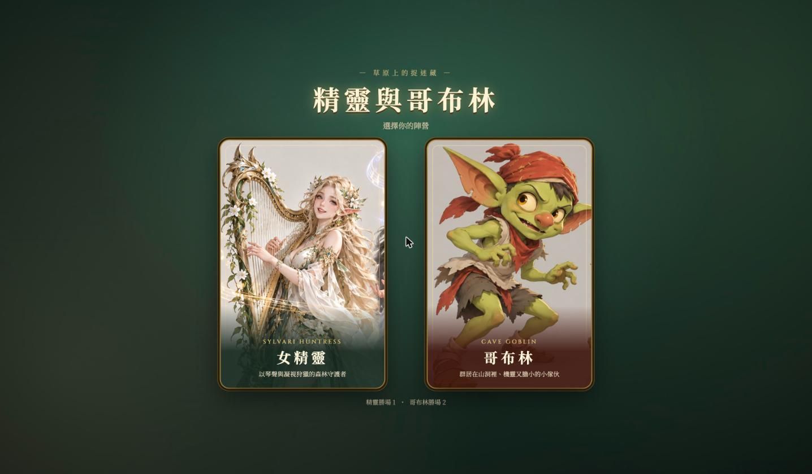
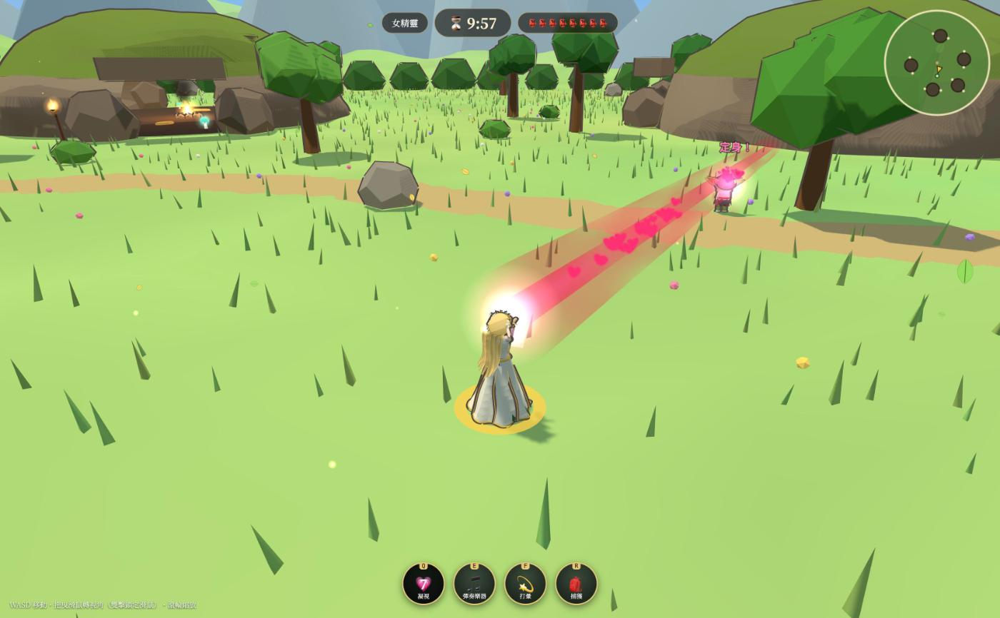
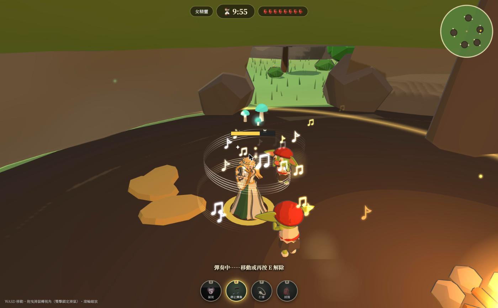
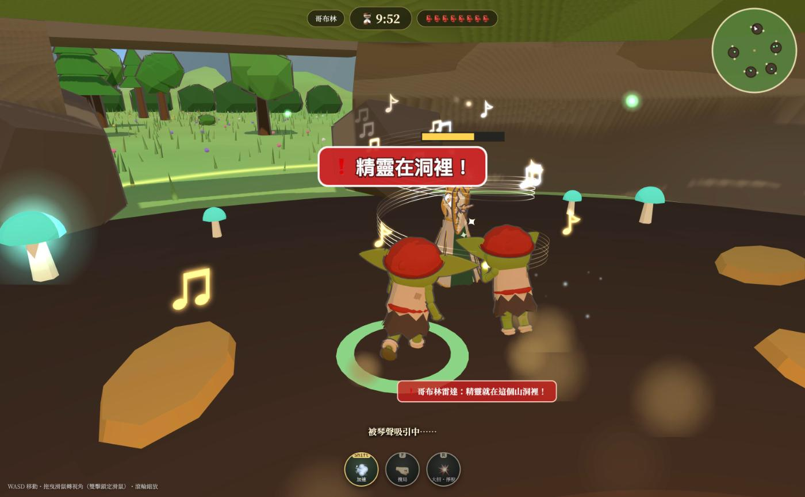
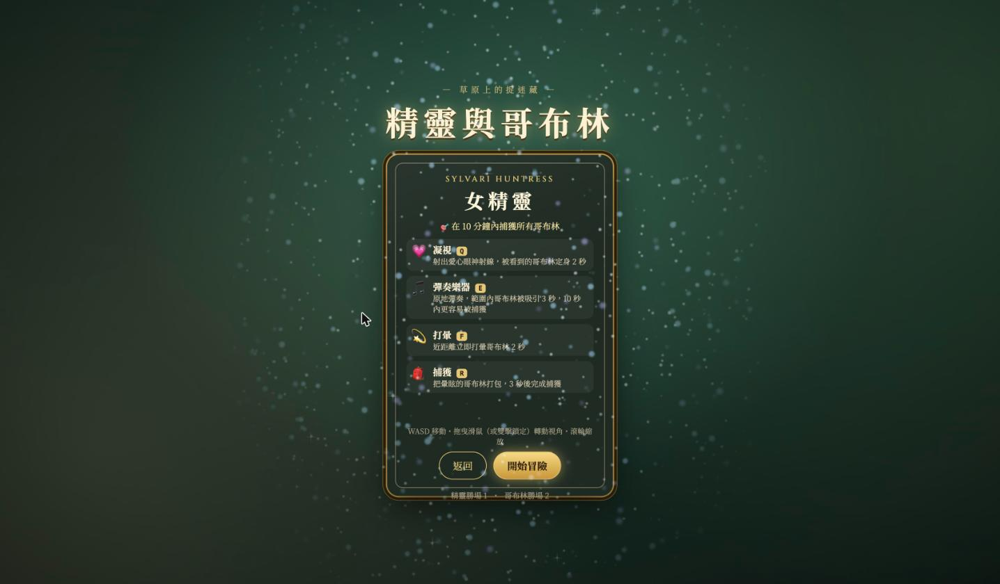

<div align="center">

# 🧝‍♀️ 快逃啊，哥布林！女精靈來山洞了 👺

**Elf & Goblins — 草原上的另類鬼抓人**

一款以 Three.js 打造、薩爾達風卡通渲染的 3D 瀏覽器小遊戲。
扮演優雅的女精靈狩獵整窩哥布林，或是成為機靈的哥布林，和夥伴們一起撐過 10 分鐘！


### [🎮 線上試玩 → michelo851a1203.github.io/catch-goblin](https://michelo851a1203.github.io/catch-goblin/)



</div>

---

## 📖 目錄

- [遊戲介紹](#-遊戲介紹)
- [遊戲畫面](#-遊戲畫面)
- [遊玩方式](#-遊玩方式)
- [角色與技能](#-角色與技能)
- [遊戲地圖](#-遊戲地圖)
- [攻略小技巧](#-攻略小技巧)
- [快速開始](#-快速開始)
- [專案結構](#-專案結構)
- [技術亮點](#-技術亮點)
- [調整遊戲平衡](#-調整遊戲平衡)

---

## 🌿 遊戲介紹

在一望無際的大草原上，散落著好幾座**哥布林山洞**。哥布林們一向成群住在洞裡，直到某天，一位手持豎琴的**女精靈**來到草原，開始了她的狩獵……

這是一款**非對稱的鬼抓人遊戲**：

| | 🧝‍♀️ 女精靈 | 👺 哥布林 |
|---|---|---|
| **人數** | 1 名（獨自行動） | 8 隻（群居，你操控其中 1 隻，其餘由 AI 控制） |
| **出生點** | 草原中央的牢籠旁 | 各個哥布林山洞裡 |
| **目標** | 10 分鐘內**捕獲所有**哥布林 | 只要有**任何一隻**撐到 10 分鐘結束就獲勝 |
| **優勢** | 跑得快、技能多、控場強 | 數量多、會團隊合作、有山洞可躲 |

> ⚖️ **平衡設計**：整體是**對精靈有利**的。哥布林必須靠團隊合作與智慧才有機會獲勝，但遊戲也經過調整，不會讓操作哥布林的玩家太快出局。

---

## 📸 遊戲畫面

<table>
  <tr>
    <td width="50%"><p align="center"><b>💗 凝視</b>：愛心眼神射線定住哥布林</p></td>
    <td width="50%"><p align="center"><b>🎵 彈奏樂器</b>：五線譜環繞，吸引附近的哥布林</p></td>
  </tr>
  <tr>
    <td width="50%"><p align="center"><b>📡 哥布林雷達</b>：精靈闖進山洞時發出警告</p></td>
    <td width="50%"><p align="center"><b>🃏 選角翻牌</b>：卡片翻到中央，夢幻藍色靈粉灑落</p></td>
  </tr>
</table>

---

## 🎮 遊玩方式

1. **選擇陣營**：點擊左邊的「女精靈」或右邊的「哥布林」卡片，卡片會翻面並移到畫面中央，同時灑下夢幻的藍色靈粉，背面列出技能說明。
2. **開始冒險**：按下「開始冒險」，倒數 3 秒後遊戲開始。
3. **勝負判定**：
   - 🧝‍♀️ 精靈在 10 分鐘內把所有哥布林抓進牢籠 → **精靈勝利**
   - 👺 時間到時還有哥布林沒被抓到 → **哥布林勝利**
4. **觀戰模式**：你操控的哥布林被抓後會進入觀戰，可以按 `Tab` 切換觀看其他同伴，也可以開啟 ⏩ 快轉 x4。

### ⌨️ 共通操作

| 按鍵 | 功能 |
|:---:|---|
| `W` `A` `S` `D` | 移動 |
| 滑鼠拖曳 / `←` `→` | 旋轉視角 |
| 滑鼠雙擊 | 鎖定滑鼠（像 FPS 一樣用滑鼠轉視角，`Esc` 解除） |
| 滾輪 | 拉近 / 拉遠鏡頭 |

> 💡 畫面下方的技能圖示也可以直接用滑鼠點擊施放。

---

## ✨ 角色與技能

### 🧝‍♀️ 女精靈 — *Sylvari Huntress*

> 以琴聲與凝視狩獵的森林守護者，移動速度比哥布林快。

| 按鍵 | 技能 | 效果 | 冷卻 |
|:---:|---|---|:---:|
| `Q` | 💗 **凝視** | 朝前方射出愛心眼神射線，被照到的哥布林**定身 2 秒**（會被岩石、洞壁擋住） | 7 秒 |
| `E` | 🎵 **彈奏樂器** | 原地彈奏豎琴（最長 5 秒，期間不能移動，移動或再按 `E` 解除）。範圍內的哥布林會被**吸引 3 秒**朝你走來，且 **10 秒內被捕獲的時間減半** | 18 秒 |
| `F` / 左鍵¹ | 💫 **打暈** | 近距離立即把哥布林**打暈 2 秒** | 3.5 秒 |
| `R` / 右鍵¹ | 🎒 **捕獲** | 把**已打暈**的哥布林裝進麻袋，**3 秒**後完成捕獲（被琴聲迷住的只要 1.4 秒）。期間可能被其他哥布林攪局 | — |

> ¹ 滑鼠按鍵施放技能需要先雙擊畫面鎖定滑鼠。

**🔗 推薦連招**：`凝視` 定身 → 跑過去 `打暈` → `捕獲` 打包！

### 👺 哥布林 — *Cave Goblin*

> 群居在山洞裡，機靈又膽小的小傢伙。

| 按鍵 | 技能 | 效果 | 冷卻 |
|:---:|---|---|:---:|
| `Shift` / `Q` | 💨 **加速** | 短時間衝刺，持續 **2 秒** | 10 秒 |
| `F` / 左鍵¹ | 🤜 **攪局** | 衝到正在打包同伴的精靈身邊施放，**打斷捕獲並救出同伴**，精靈會短暫暈頭 | 6 秒 |
| `R` | 💥 **大招・掙脫** | 自己被打包時使用，**直接掙脫**並短暫加速。**整場只能用一次！** | 一次性 |
| 被動 | 📡 **哥布林雷達** | 精靈進入你所在的山洞時，頭上會跳出「❗ 精靈在洞裡！」警告並響起警報 | — |

> ¹ 滑鼠按鍵施放技能需要先雙擊畫面鎖定滑鼠。

---

## 🗺️ 遊戲地圖

```
              🏔️  🏔️  遠方雪山  🏔️  🏔️
        ┌───────────────────────────────────┐
        │        🕳️ 北岩洞                   │
        │   🌳        🌳          🌲        │
        │                                   │
        │ 🕳️ 西骨洞    🔒 牢籠    🕳️ 東苔洞 │
        │              🧝‍♀️                  │
        │   🌲     🪨          🌳           │
        │        🕳️ 南根洞   🕳️ 老哥布林窟  │
        └───────────────────────────────────┘
```

- **🌾 大草原**：開闊的草地，散布著樹木、岩石與小徑。精靈的視野在這裡最好，哥布林在外面跑很危險！
- **🕳️ 哥布林山洞（5 座）**：每座都有**兩個洞口**，裡面有營火、發光蘑菇和可以躲在後面的石柱。從洞外看不到洞裡，是哥布林的避風港。
- **🔒 牢籠**：位於草原中央，被捕獲的哥布林會裝在麻袋裡飛進這裡。

---

## 🧠 攻略小技巧

<details>
<summary><b>🧝‍♀️ 精靈篇</b>（點擊展開）</summary>

- 山洞只有兩個出口，**堵在洞口彈琴**可以把裡面的哥布林吸出來。
- 被琴聲迷住的哥布林只要 1.4 秒就能打包完成，記得**先彈琴再抓**。
- 打包時如果附近有其他哥布林，牠們很可能會來攪局。先清掉旁邊的，再慢慢處理。
- 凝視會被岩石和洞壁擋住，盡量在**開闊處**施放。

</details>

<details>
<summary><b>👺 哥布林篇</b>（點擊展開）</summary>

- 頭上跳出「❗ 精靈在洞裡！」時，**立刻從另一個洞口逃走**。
- 加速有 10 秒冷卻，留到精靈**快抓到你的時候**再用。
- 同伴被打包時，衝過去按 `F` 攪局！精靈會暈頭一下，大家都能趁機逃跑。
- 大招只有一次，**被打包時才能用**，千萬別浪費。
- 聽到琴聲就趕快遠離，被吸引會很難逃。

</details>

---

## 🚀 快速開始

### 環境需求

- [Bun](https://bun.sh/)（推薦），或 Node.js 20.19+ 搭配 npm
- 支援 WebGL 2 的瀏覽器（Chrome / Edge / Firefox / Safari 最新版）

### 安裝與執行

```bash
# 1. 下載專案
git clone https://github.com/michelo851a1203/catch-goblin.git
cd catch-goblin

# 2. 安裝套件
bun install        # 或 npm install

# 3. 啟動開發伺服器
bun run dev        # 或 npm run dev
```

開啟終端機顯示的網址（預設 `http://localhost:5173`）就能開始玩了！

### 打包正式版

```bash
bun run build      # 輸出到 dist/
bun run preview    # 本機預覽打包結果
```

`dist/` 是純靜態檔案，可以直接部署到任何靜態網站平台。

### 🌐 部署到 GitHub Pages

推送到 `main` 分支後，[`.github/workflows/deploy.yml`](.github/workflows/deploy.yml) 會自動打包並部署。
第一次使用前，請到 repo 的 **Settings → Pages → Build and deployment → Source** 選擇 **GitHub Actions**。

> 部署時會用 `BASE_PATH=/<repo 名稱>/` 打包，讓資源路徑對應 GitHub Pages 的子路徑；本機開發不受影響。

### 🧪 測試用網址參數

| 參數 | 說明 |
|---|---|
| `?role=elf` / `?role=goblin` | 跳過選角，直接以指定陣營開始 |
| `?fast=90` | 把一局的時間縮短為 90 秒（可自訂秒數） |

例如：`http://localhost:5173/?role=goblin&fast=120`

---

## 📁 專案結構

```
goblin-game/
├── src/
│   ├── App.vue                    # 畫面切換（選角 ↔ 遊戲）
│   ├── stats.ts                   # 戰績紀錄（localStorage）
│   ├── components/
│   │   ├── CharacterSelect.vue    # 選角畫面與卡片翻轉動畫
│   │   └── GameView.vue           # 遊戲 HUD：計時、技能列、小地圖、結算
│   ├── game/
│   │   ├── Game.ts                # 遊戲主迴圈、技能、鏡頭、導航
│   │   ├── ai.ts                  # 精靈 / 哥布林 AI
│   │   ├── config.ts              # ⚖️ 所有平衡數值
│   │   ├── entities.ts            # 角色實體與狀態
│   │   ├── models.ts              # 程式化建模的 3D 角色與動畫
│   │   ├── world.ts               # 草原、山洞、牢籠、碰撞與視線
│   │   ├── toon.ts                # 卡通材質與文字看板
│   │   ├── audio.ts               # WebAudio 合成音效
│   │   └── fx/
│   │       ├── Particles.ts       # GPU 粒子系統
│   │       ├── Effects.ts         # 技能特效、環境特效
│   │       └── atlas.ts           # 粒子貼圖集
│   └── assets/art/                # 選角卡片立繪
└── docs/screenshots/              # README 截圖
```

---

## 🛠️ 技術亮點

- **🎨 薩爾達風卡通渲染**：`MeshToonMaterial` 三階色調加上 `OutlineEffect` 描邊。
- **🧩 全程式化建模**：角色、山洞、樹木等 3D 模型全部用程式生成，**沒有使用任何外部 3D 模型檔**。
  - 角色有分節骨架、眨眼與表情變化
  - 頭髮與布料有彈簧般的二次擺動
- **✨ 自製 GPU 粒子系統**：單一 draw call 的點粒子，負責火焰、螢火蟲、花瓣、愛心、音符等效果。
- **🌈 Shader 特效**：凝視光束（菲涅耳光暈 + 能量脈衝）、環繞的發光五線譜、擴散光環。
- **🪄 Shaders 靈粉**：選角翻牌時的藍色靈粉由 [Shaders](https://shaders.com) 的 `FloatingParticles` + `Sparkle` 組成（需支援 WebGPU 的瀏覽器）。
- **🤖 遊戲 AI**：
  - 哥布林會逃跑、躲進洞裡、搬家，也會去救同伴、使用大招
  - 精靈會巡邏、追擊、預判，並在適當時機施放技能
- **🔊 零音檔**：所有音效與豎琴旋律都由 WebAudio 即時合成。
- **💾 免後端**：遊戲過程不存檔，只把勝場數存在 `localStorage`。

---

## ⚖️ 調整遊戲平衡

所有數值都集中在 [`src/game/config.ts`](src/game/config.ts)，例如：

```ts
export const CONFIG = {
  matchDuration: 600,   // 一局秒數（10 分鐘）
  goblinCount: 8,       // 哥布林數量
  goblin: { speed: 6.0, dashDuration: 2, dashCooldown: 10, /* ... */ },
  elf: {
    speed: 7.4,         // 玩家精靈速度
    aiSpeed: 6.2,       // AI 精靈速度（調高 = 對哥布林玩家更難）
    gaze:  { range: 24, root: 2, cooldown: 7 },
    music: { radius: 17, attractTime: 3, charmTime: 10, cooldown: 18 },
    // ...
  },
}
```

想讓哥布林更好過？試著降低 `elf.aiSpeed` 或增加 `goblinCount`！

---

<div align="center">

用 💚 與 ☕ 製作 · 歡迎提出 Issue 或 PR！

</div>
